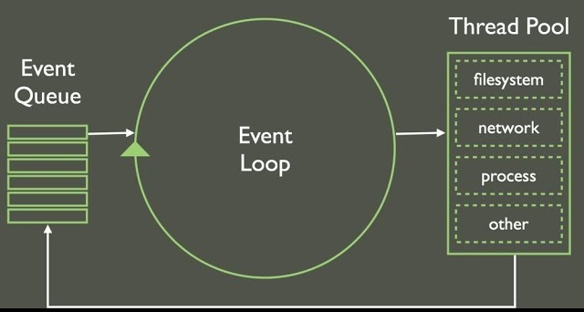
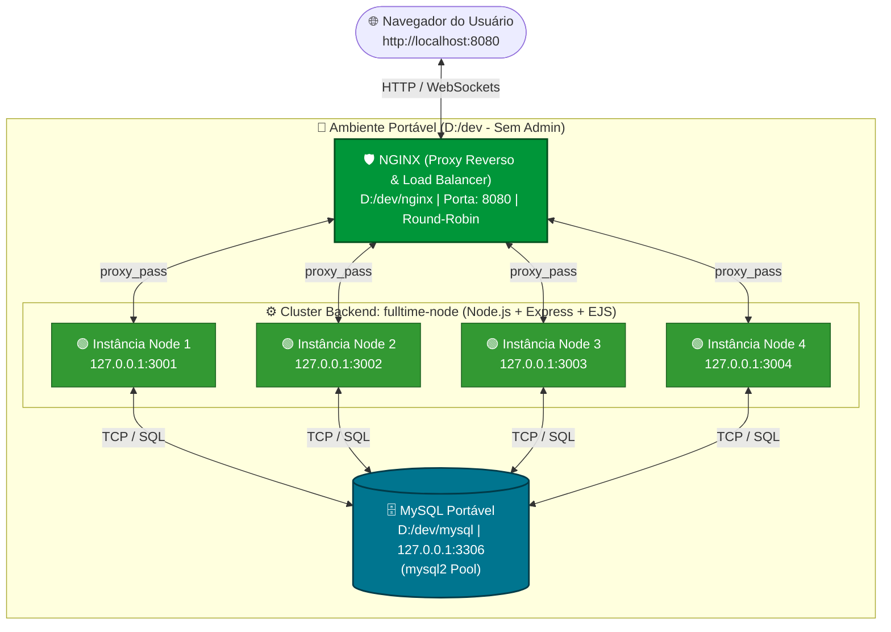

# 🌐 FullTime Node — Arquitetura Portável (NGINX + Cluster Node.js + MySQL)

Sistema web completo e portável projetado para execução direta em pendrive/drive local sem necessidade de privilégios de administrador, utilizando proxy reverso e balanceamento de carga com **NGINX**, múltiplas instâncias **Node.js/Express (EJS)** e persistência em **MySQL**.

---

   O Sistema FullTime-Node é um sistema não bloqueante e escalável que se baseia nos loops de evento do NGINX
e NodeJs

NGINX é um Proxy Reverso e NodeJs é um Servidor Web. Ambos são orientados a eventos e não bloqueantes, são assíncronos!
assim cada requisição HTTP que chega, gera um callback (função assíncrona) e libera o ssitema para a próxima requisição.
Desta maneira, a disponibilidade é altíssima, pois o sistema continua recebendo e processando as demais requisições, quando
há uma resposta, ela é automaticamente encaminhada à requisição origem. 

O Proxy reverso NGINX foi configurado aqui para gerar 4 instâncias do servidor NodeJs (server.js), que estão escutando respectivamente
nas portas TCP 3001, 3002, 3003, 3004, assim, quando um está ocupado o outro responde outra requisição que chega. A disponibilidade é
altíssima e como os servidores web são virtuais, gerados pelo proxy reverso, eles pode ser acrescidos de mais instâncias o que promove
uma escalabilidade imensa. Além disso o proxy reverso fornece o balanceamento de carga, que é justamente equilibrar estas requisições 
entre as instâncias do servidor web.

---

## Loop de eventos de NodeJs



## 🏗️ Diagrama de Arquitetura (Proxy Reverso e Balanceamento)


---

## 📁 Estrutura de Diretórios do Ambiente

```text
D:/dev/
├── nginx/                     # Binários portáveis do NGINX
│   ├── conf/
│   │   └── nginx.conf         # Configuração de upstream (4 portas) e proxy reverso
│   ├── logs/                  # Logs de acesso e erros do proxy
│   └── nginx.exe              # Executável principal
│
├── nodejs/                    # Binários portáveis do Node.js
│   ├── node.exe               # Runtime Node.js
│   └── npm.cmd                # Gerenciador de pacotes
│
├── mysql/                     # Binários e dados do MySQL Portável
│   ├── bin/
│   │   ├── mysqld.exe         # Servidor MySQL
│   │   └── mysql.exe          # Cliente CLI
│   └── data/                  # Arquivos do banco de dados
│
├── fulltime-node/             # Aplicação Web Principal
│   ├── public/                # Arquivos estáticos (CSS, Bootstrap, JS client, imagens)
│   │   ├── css/
│   │   └── js/
│   ├── views/                 # Templates dinâmicos EJS
│   │   ├── partials/          # Componentes reutilizáveis (navbar.ejs, footer.ejs)
│   │   └── index.ejs          # Página principal
│   ├── json/                  # Bases auxiliares / fallback JSON
│   ├── config/
│   │   └── db.js              # Conexão e Pool MySQL (mysql2)
│   ├── server.js              # Servidor Express (aceita porta dinâmica via ENV PORT)
│   ├── package.json           # Dependências (express, ejs, mysql2)
│   └── README.md              # Documentação da arquitetura
│
├── iniciar_ambiente.bat       # Sobe MySQL, 4 instâncias Node.js e NGINX
└── parar_ambiente.bat         # Encerra todos os serviços com segurança
```

---

## 🔄 Fluxo de Funcionamento

1. **Entrada Única (`D:/dev/nginx` — Porta `8080`):**
   * O usuário acessa `http://localhost:8080`.
   * Como não há direitos de administrador, o NGINX escuta na porta `8080` (acima de `1024`) e atua como proxy reverso.
   * Distribui as requisições recebidas entre as 4 instâncias do `fulltime-node` via bloco `upstream`.
2. **Camada de Aplicação (`D:/dev/fulltime-node` — Portas `3001` a `3004`):**
   * Executada utilizando o binário portável em `D:/dev/nodejs/node.exe`.
   * Quatro processos independentes do `server.js` rodam simultaneamente nas portas `3001`, `3002`, `3003` e `3004`.
3. **Camada de Dados (`D:/dev/mysql` — Porta `3306`):**
   * Todas as 4 instâncias compartilham o mesmo banco MySQL portável utilizando `mysql2` com *connection pool*, garantindo consistência nos dados de autenticação e cadastros independentemente de qual instância atendeu a requisição.

---

## 🚀 Como Executar

1. Execute o script **`iniciar_ambiente.bat`** em `D:/dev/` para iniciar:
   * O servidor **MySQL Portável** (`D:/dev/mysql/bin/mysqld.exe` na porta `3306`)
   * As **4 instâncias do Node.js** (`D:/dev/nodejs/node.exe` rodando `fulltime-node/server.js` nas portas `3001` a `3004`)
   * O **NGINX** (`D:/dev/nginx/nginx.exe` na porta `8080`)
2. Acesse no navegador: **`http://localhost:8080`**
3. Ao finalizar o trabalho, execute **`parar_ambiente.bat`** para encerrar os processos com segurança.
